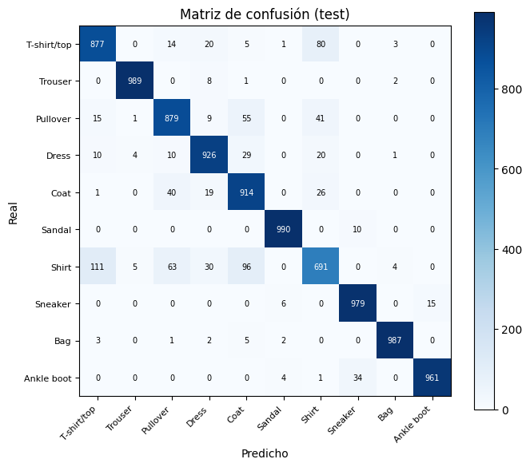
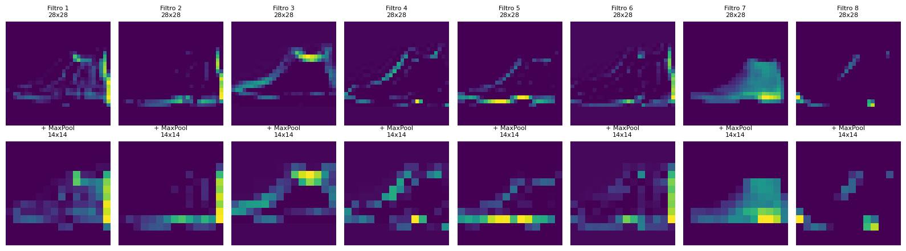

# Anatomía de una CNN: clasificación de ropa con Fashion-MNIST

Red neuronal convolucional en **TensorFlow/Keras** para clasificar 10 tipos de prendas, con foco en **entender qué aprende cada capa**: mapas de activación, curvas de entrenamiento, análisis de errores y comparación de arquitecturas.

Trabajo práctico de *Inteligencia Artificial y Aprendizaje Automático*, Licenciatura en Ciencia de Datos (UCA, 2026). Trabajo en dupla: Lucía Formenti · **Juan Cruz Montero**.

## Resultados

| Modelo | Arquitectura | Parámetros | Accuracy (test) |
|---|---|---|---|
| Base | 2 bloques Conv2D + MaxPooling + Dropout | 421.642 | **91,9 %** |
| v2 | 3 bloques Conv2D (32 → 64 → 128 filtros) | 241.546 | **91,9 %** |

- El modelo v2 iguala la accuracy con **43 % menos de parámetros** y una val_loss levemente menor: el bloque extra reduce la dimensión antes de la capa densa.
- Las confusiones se concentran en prendas de torso parecidas: **camisa → remera** (111 casos), **camisa → abrigo** (96) y **remera → camisa** (80). Calzado, pantalones y bolsos superan el 96 % de recall.



## Qué aprende la primera capa

Salida de los filtros de la primera Conv2D sobre una bota, antes y después del MaxPooling. Cada filtro se especializa en bordes, contornos o texturas distintas.



## Contenido del notebook

1. Carga y normalización de Fashion-MNIST (60.000 imágenes de entrenamiento y 10.000 de test)
2. Construcción y compilación de la CNN
3. Entrenamiento con validación y curvas de accuracy y loss
4. Visualización de mapas de activación con submodelos
5. Evaluación: classification report y matriz de confusión
6. Experimentación con una arquitectura alternativa y comparación

## Cómo correrlo

```bash
pip install tensorflow scikit-learn matplotlib numpy
jupyter notebook cnn_fashion_mnist.ipynb
```

El dataset se descarga automáticamente con `tf.keras.datasets.fashion_mnist`.

## Stack

Python · TensorFlow/Keras · scikit-learn · NumPy · Matplotlib

---

**Juan Cruz Montero** · Estudiante de Lic. en Ciencia de Datos (UCA) · [LinkedIn](https://www.linkedin.com/in/juan-cruz-montero-a14474431)
